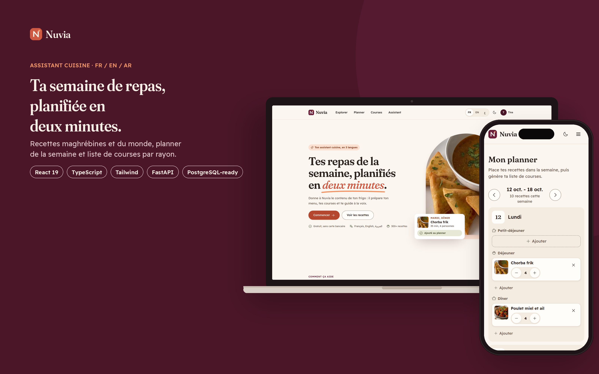
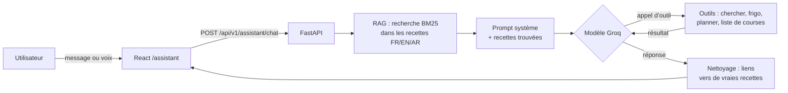
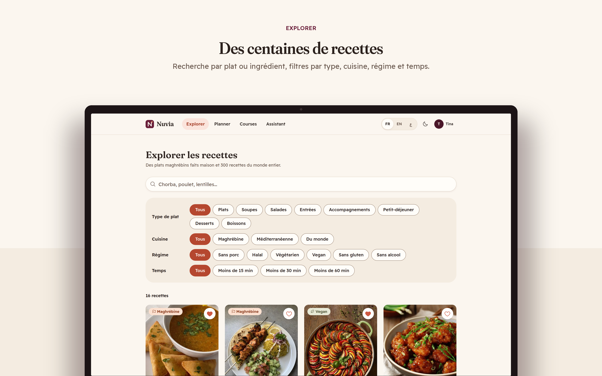
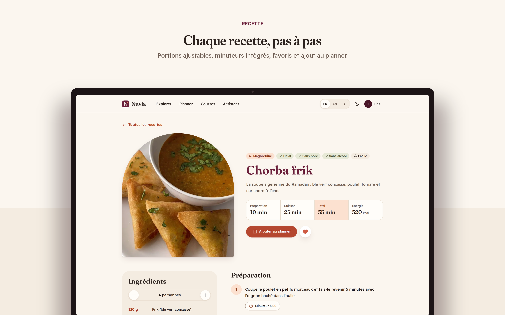
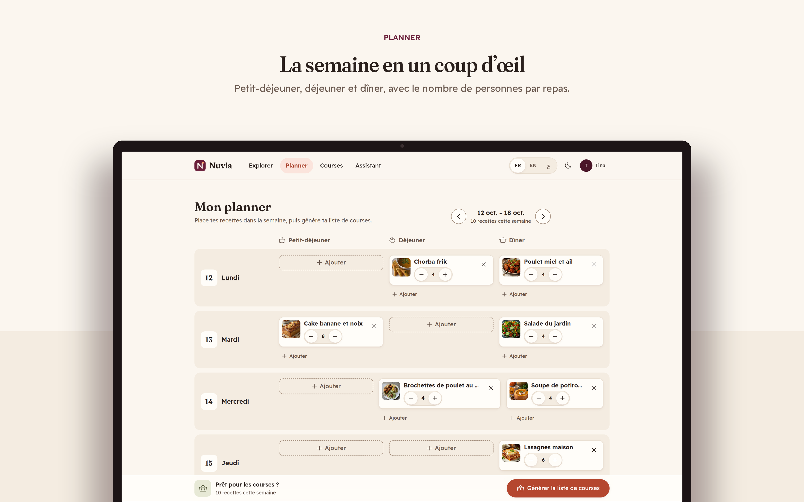
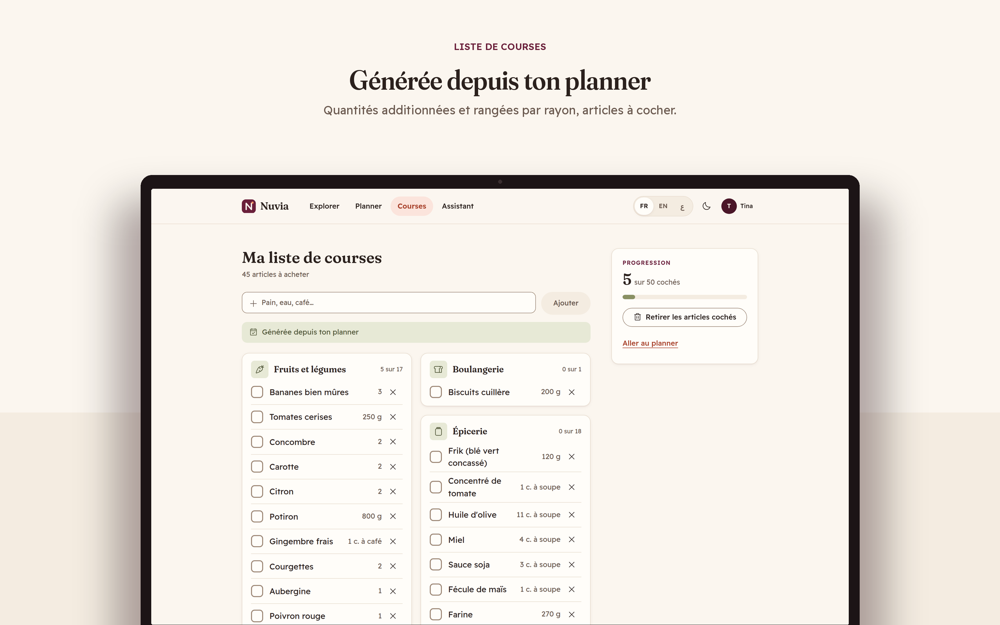
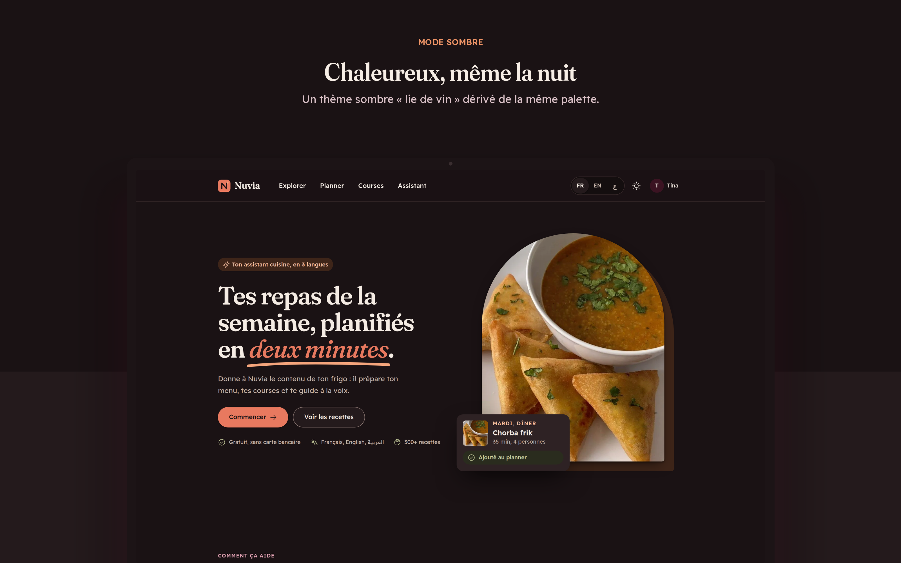
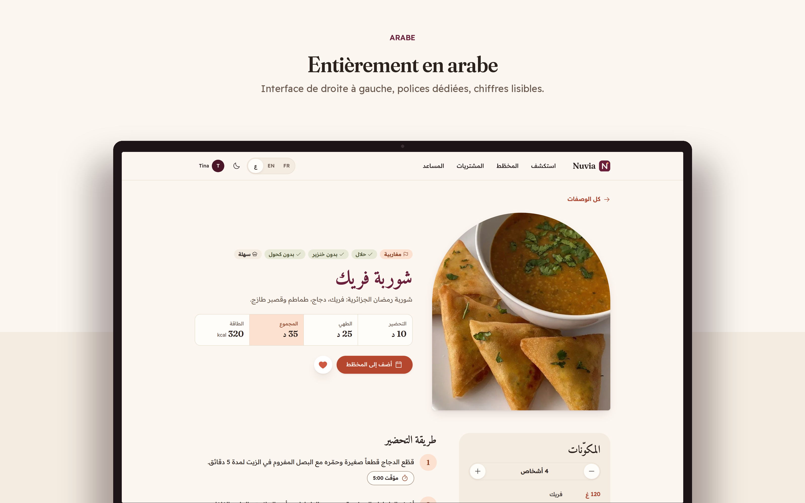
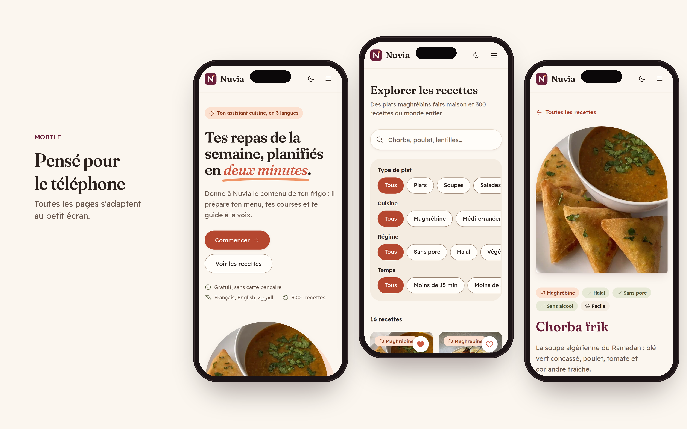
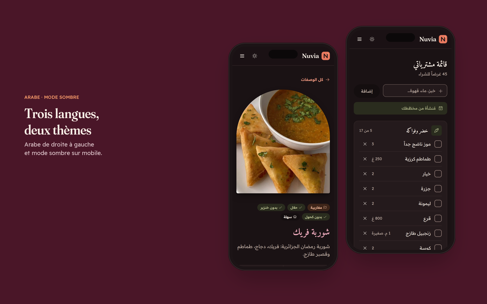

# Nuvia

**Assistant de cuisine trilingue (français, anglais, arabe) : trouver quoi manger, planifier la semaine, faire les courses, avec un agent IA qui agit pour toi.**



Nuvia met la cuisine maghrébine faite maison au premier plan (chorba, rechta, mhadjeb, couscous) à côté d’environ 300 recettes du monde avec photos. Toute l’interface existe en français, en anglais et en arabe (de droite à gauche), en mode clair et sombre, sur ordinateur et sur téléphone.

## Fonctionnalités

| | |
| --- | --- |
| **Explorer** | Recherche par plat ou ingrédient, filtres par type, cuisine, régime (halal, végétarien, vegan, sans gluten) et temps. |
| **Recette** | Portions ajustables qui recalculent les quantités, minuteurs intégrés aux étapes, favoris, recettes similaires. |
| **Cuisiner avec mon frigo** | Tu listes ce que tu as, Nuvia classe les recettes qui l’utilisent le plus et indique ce qui manque. |
| **Planner** | Petit-déjeuner, déjeuner et dîner pour chaque jour de la semaine, avec le nombre de personnes par repas. |
| **Liste de courses** | Générée depuis le planner : quantités mises à l’échelle, additionnées et rangées par rayon. |
| **Assistant IA** | Un agent qui cherche dans les recettes de Nuvia et agit : il ajoute au planner, complète la liste, génère les courses. À l’écrit ou à la voix. |
| **Compte** | Inscription et connexion sécurisées, profil, langue, changement de mot de passe, suppression du compte. |

## L’agent IA

L’assistant n’est pas un simple chatbot : c’est un **agent avec outils** construit à la main en Python, sans framework.



- **RAG** : un index BM25 en mémoire (titres, ingrédients, tags) trouve les recettes utiles dans les trois langues et les place dans le prompt.
- **7 outils** : `search_recipes`, `find_recipes_with_ingredients`, `get_recipe`, `get_meal_plan`, `add_to_meal_plan`, `add_to_shopping_list`, `generate_shopping_list`.
- **Boucle d’agent** : jusqu’à 5 allers-retours modèle → outils → modèle, puis une réponse finale.
- **Sécurité** : les outils ne voient que les données de l’utilisateur connecté, ne font qu’ajouter (jamais supprimer), valident tout ce que le modèle envoie, et chaque action est affichée à l’utilisateur. Le modèle ne peut citer que des recettes qui existent.
- **Tests** : l’agent est testé avec un faux modèle (aucune clé, aucun réseau).

Le fonctionnement détaillé est expliqué dans [docs/AGENT.md](docs/AGENT.md).

## Captures

| | |
| --- | --- |
|  |  |
|  |  |
|  |  |
|  |  |

## Stack technique

| Couche | Outils |
| --- | --- |
| Front-end | React 19, TypeScript, Vite, Tailwind CSS v4, TanStack Query, React Router, i18next, Motion, Phosphor Icons |
| Back-end | Python, FastAPI, SQLAlchemy 2, Alembic, Pydantic, SQLite (prêt pour PostgreSQL) |
| IA | Groq (offre gratuite, API compatible OpenAI), agent et RAG écrits à la main, Web Speech API pour la voix |
| Sécurité | Argon2id, JWT en cookies httpOnly avec rotation des refresh tokens, limitation de débit, en-têtes de sécurité |
| Qualité | pytest (52 tests), Vitest + Testing Library (29 tests), Playwright, Ruff, oxlint, GitHub Actions, Dependabot |
| Design | Design system « Terracotta table » : bordeaux, cuivre, abricot, mousse ; Fraunces, Amiri et Readex Pro |

## Lancer le projet en local

Prérequis : Python 3.10+ et Node.js 20+. Tout est gratuit, aucune carte bancaire n’est nécessaire.

**1. L’API** (Windows, PowerShell)

```powershell
cd backend
python -m venv .venv
.venv\Scripts\Activate.ps1
pip install -r requirements-dev.txt
copy .env.example .env      # puis remplis JWT_SECRET (et GROQ_API_KEY pour l’assistant)
alembic upgrade head
python -m app.seed                 # 12 recettes écrites pour Nuvia (FR / EN / AR)
python -m app.importers.themealdb  # ~300 recettes avec photos (optionnel)
uvicorn app.main:app --reload --port 8000
```

**2. Le site**, dans un deuxième terminal

```powershell
cd frontend
npm install
npm run dev
```

Ouvre http://localhost:5173. La documentation de l’API est sur http://localhost:8000/docs.

**3. L’assistant IA (optionnel)** : crée une clé gratuite sur [console.groq.com/keys](https://console.groq.com/keys) et ajoute `GROQ_API_KEY=...` dans `backend/.env`. Sans clé, tout le reste de l’application fonctionne et la page Assistant l’explique.

**Tests**

```powershell
cd backend;  pytest
cd frontend; npm test
```

## Structure

```
nuvia/
├── backend/
│   ├── app/
│   │   ├── routers/      auth, users, recipes, planner, assistant
│   │   ├── services/     agent.py, retrieval.py, pantry.py, shopping.py, aisles.py
│   │   ├── models/       SQLAlchemy
│   │   ├── importers/    TheMealDB
│   │   └── seed/         recettes Nuvia en trois langues
│   ├── migrations/       Alembic
│   └── tests/            pytest
├── frontend/
│   └── src/
│       ├── pages/        Landing, Explore, Recipe, Fridge, Planner, Shopping, Assistant, Account…
│       ├── features/     logique par domaine (auth, recipes, planner, assistant, account)
│       ├── components/   UI et layout
│       └── i18n/         fr, en, ar
├── docs/                 AGENT.md, maquettes
└── .github/              CI et Dependabot
```

## Crédits

- Une partie des recettes et des photos vient de [TheMealDB](https://www.themealdb.com), cité sur chaque recette concernée.
- Projet personnel de portfolio conçu et développé par **Tina**.
